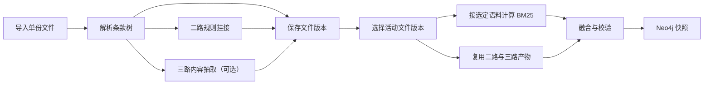

# 架构与数据模型

`src/` 采用 Python 包布局。安装后的 `clausegraph` 提供 SDK 与 CLI。项目工作台通过 FastAPI 调用同一套项目和快照接口。

| 目录或模块 | 职责 |
| --- | --- |
| [parsing.py](../src/clausegraph/parsing.py) · [contracts.py](../src/clausegraph/contracts.py) | 解析文档，定义和校验条款树、图及证据 |
| [bm25.py](../src/clausegraph/bm25.py) · [ontology.py](../src/clausegraph/ontology.py) · [extraction.py](../src/clausegraph/extraction.py) | 分别实现一路 BM25、二路规则挂接和三路内容抽取 |
| [graphs.py](../src/clausegraph/graphs.py) · [publishing.py](../src/clausegraph/publishing.py) | 公共底图、路线校验、图融合和 Neo4j 发布 |
| [engine.py](../src/clausegraph/engine.py) · [cli.py](../src/clausegraph/cli.py) | 清单批处理与命令行入口 |
| [projects.py](../src/clausegraph/projects.py) · [workbench.py](../src/clausegraph/workbench.py) · [web/](../src/clausegraph/web/) | 项目文件入库、快照编排、工作台 API 和页面 |
| [tests/](../tests/) · [examples/](../examples/) · [scripts/](../scripts/) | 自动化测试与夹具、合成示例和规模基准 |

## 两种运行方式

批处理按 JSON 清单读取文件与本体，依次生成条款树、公共底图、各路线图、总图及运行报告。Neo4j 可随运行发布，也可以用保存的总图单独发布。启用的路线失败时，运行报告记录失败阶段，已经生成的本地产物可以用于排查。

项目模式将单文件入库和多文件快照拆开。导入时保存条款树、二路结果和可选的三路结果。相同输入及配置可复用当前活动版本。替换后旧版本退出活动列表，历史快照仍引用它。生成新快照时，从本项目选取活动文件版本，按选择范围重建公共底图和 BM25，复用已经入库的二路、三路产物。

## 契约与追溯

条款树记录 `document_id`、原件 SHA-256、解析器版本和可选文档类型。标题形成层级，前言归入根节点，父条款保存自己的直属内容。DOCX 用主体块序号定位，Markdown 用行范围定位，表格证据额外记录行号。图中的条款 ID 由文档 ID、原件哈希、解析器版本和树内条款 ID 派生。

图记录数据集、路线、状态、底图和配置指纹。公共节点为 `Document` 与 `Clause`，二路概念为 `TypeConcept`，三路概念为 `ContentConcept`。融合按边类型、方向、端点和谓词归并，保留各路线的断言及证据。校验会拒绝底图不一致、节点冲突、无效端点和无法回查的证据。

Neo4j 发布使用[数据契约 v2](neo4j-contract.md)。工作台按存储版本生成查询。新快照用 `CLASSIFIED_AS` 和 `MENTIONS` 区分本体归类和内容提及，文档版本持有原文来源，断言保存位置引用。发布在事务中核对节点数和业务边数，同一份总图和版本绑定可重复发布。

可用 `clausegraph schema tree`、`clausegraph schema graph` 和 `clausegraph schema manifest` 导出机器可读契约。
